# Master Research Dossier: The Seven Long Surahs (Al-Sabʿ al-Ṭiwāl)
## Comprehensive Sequence Analysis & Munāsabāt: Surahs 1 through 9

**Research Division:** Antigravity Qur'anic Research Engine  
**Tradition:** Orthodox Sunni *Munāsabāt* & *ʿUlūm al-Qur'ān*  
**Corpus Scope:** Surah 1 (Al-Fātiḥah) through Surah 9 (At-Tawbah)  
**Primary Authorities:** Burhān al-Dīn al-Biqāʿī (*Naẓm al-durar*), Ibn al-Zubayr al-Gharnāṭī (*Al-Burhān fī tartīb suwar al-Qur'ān*), Jalāl al-Dīn al-Suyūṭī (*Tanāsuq al-durar*), Fakhr al-Dīn al-Rāzī (*Mafātīḥ al-ghayb*), Ibn ʿĀshūr (*Al-Taḥrīr wa al-tanwīr*).

---

### Core Slogan & Operating Axiom
> *"Each surah is unique and has a different personality."*  
> The Seven Long Surahs (*Al-Sabʿ al-Ṭiwāl*) do not constitute a monolithic legislative block; rather, each surah possesses an autonomous spiritual identity, a distinct theological axis (*Maqṣad*), and an individual rhetorical cadence (*Jaww al-Sūrah*), while forming an unbroken chain of consecutive transitions across the canonical muṣḥaf.

---

## 1. Sequence Overview & Thematic Progression

```mermaid
flowchart LR
    S1["1. Al-Fātiḥah<br/><b>Devotional Gateway</b><br/><i>Petition for Guidance</i>"] --> S2["2. Al-Baqarah<br/><b>The Constitution</b><br/><i>Guidance Provided & Law</i>"]
    S2 --> S3["3. Āl ʿImrān<br/><b>The Shield</b><br/><i>Steadfastness & Defense</i>"]
    S3 --> S4["4. An-Nisā'<br/><b>Social Justice</b><br/><i>Orphans, Family, Law</i>"]
    S4 --> S5["5. Al-Mā'idah<br/><b>Inviolable Covenants</b><br/><i>Sacraments, Contracts</i>"]
    S5 --> S6["6. Al-Anʿām<br/><b>Cosmic Tawḥīd</b><br/><i>Ontology, Creation</i>"]
    S6 --> S7["7. Al-Aʿrāf<br/><b>The Great Drama</b><br/><i>History, Prophetic Cycles</i>"]
    S7 --> S8["8. Al-Anfāl<br/><b>Victory & Hearts</b><br/><i>Martial Discipline, Alliances</i>"]
    S8 --> S9["9. At-Tawbah<br/><b>Disavowal & Repentance</b><br/><i>Treaties, Hypocrisy</i>"]
```

---

## 2. Transition Studies Across the Seven Long Surahs

### Transition 1: Al-Fātiḥah (1) → Al-Baqarah (2)
*Completed in Pilot 1:* The petition for the Straight Path (*Ihdinā al-ṣirāṭ al-mustaqīm*, 1:6) is answered by the presentation of the Book as that guidance (*Dhālika al-kitābu lā rayba fīhi hudan lil-muttaqīn*, 2:2). The three groups of 1:7 (*anʿamta ʿalayhim*, *al-maghḍūbi ʿalayhim*, *al-ḍāllīn*) unpack into the *Muttaqīn* (2:1–5), *Kāfirīn* (2:6–7), and *Munāfiqīn* (2:8–20).

---

### Transition 2: Al-Baqarah (2) → Āl ʿImrān (3)
*Completed in Pilot 2:* The terminal supplication for divine aid against disbelief (2:286: *Anta mawlānā fa-nṣurnā ʿalā al-qawm al-kāfirīn*) transitions directly into the affirmation of the Ever-Living Sustainer (3:2: *Allāhu lā ilāha illā huwa al-Ḥayyu al-Qayyūm*) and the promise of victory over disbelievers (3:12). Al-Baqarah establishes the Sharīʿah; Āl ʿImrān defends it against intellectual doubts (*Shubuhāt*) and battlefield trials at Uḥud.

---

### Transition 3: Āl ʿImrān (3) → An-Nisā' (4)
#### A. The Textual & Psychological Context
The Battle of Uḥud—exhaustively analyzed in the second half of Āl ʿImrān (3:121–180)—resulted in the martyrdom of seventy noble Muslim warriors, producing a major socio-demographic crisis in Medina: dozens of destitute widows and hundreds of fatherless orphans. 

Surah An-Nisā' opens immediately as the direct legislative and moral answer to this humanitarian aftermath.

#### B. Primary Classical Evidence
* **Burhān al-Dīn al-Biqāʿī (*Naẓm al-durar*, Vol. 5, p. 5):**  
  > "لَمَّا خَتَمَ آلَ عِمْرَانَ بِالْأَمْرِ بِالتَّقْوَى فَقَالَ: {وَاتَّقُوا اللَّهَ لَعَلَّكُمْ تُفْلِحُونَ}، افْتَتَحَ النِّسَاءَ بِالْأَمْرِ بِالتَّقْوَى أَيْضاً فَقَالَ: {يَا أَيُّهَا النَّاسُ اتَّقُوا رَبَّكُمُ الَّذِي خَلَقَكُم مِّن نَّفْسٍ وَاحِدَةٍ}، وَذَلِكَ لِأَنَّ مَا فِي النِّسَاءِ مِنْ أَحْكَامِ الْيَتَامَى وَالنِّسَاءِ جَاءَ مُعَالِجاً لِآثَارِ وَقْعَةِ أُحُدٍ الْمَذْكُورَةِ فِي آلِ عِمْرَانَ."  
  *Translation:* "When He concluded Āl ʿImrān with the command to Taqwa: *'And fear Allah that you may succeed'* [3:200], He opened An-Nisā' likewise with the command to Taqwa: *'O mankind, fear your Lord who created you from a single soul'* [4:1]. This is because the rulings regarding orphans and women in An-Nisā' arrived as a direct remedy for the consequences of the Battle of Uḥud recounted in Āl ʿImrān."
* **Ibn al-Zubayr al-Gharnāṭī (*Al-Burhān*, pp. 193–198):**  
  Al-Gharnāṭī notes the seamless transition from the macro-communal defense in Āl ʿImrān to the micro-societal stabilization of vulnerable families, orphans, and inheritance rights in An-Nisā'.

---

### Transition 4: An-Nisā' (4) → Al-Mā'idah (5)
#### A. The Textual Junction
* **Ending of An-Nisā' (4:176):**  
  Concludes with the intricate secondary inheritance law of *Kalālah*, sealing detailed civil statutes:  
  *Yubayyinu Allāhu lakum an taḍillū, wa Allāhu bi-kulli shay'in ʿalīm*  
  ("Allah makes clear to you [His law], lest you go astray. And Allah is Knowing of all things.")
* **Opening of Al-Mā'idah (5:1):**  
  Opens with the all-encompassing constitutional imperative:  
  *Yā ayyuhā alladhīna āmanū awfū bi-l-ʿuqūd*  
  ("O you who believe, fulfill all contracts and covenants!")

#### B. Primary Classical Evidence
* **Jalāl al-Dīn al-Suyūṭī (*Tanāsuq al-durar*, pp. 78–80):**  
  Al-Suyūṭī observes: After Allah detailed numerous covenants, financial trusts, marriage bounds, and inheritance divisions across An-Nisā', He opened Al-Mā'idah with the universal legal maxim commanding absolute fidelity to all covenants (*awfū bi-l-ʿuqūd*).
* **Al-Biqāʿī (*Naẓm al-durar*, Vol. 6, pp. 3–8):**  
  Surah Al-Mā'idah acts as the crowning sacramental seal of the legislative surahs, completing halal dietary laws, ritual purity (*Wuḍū' and Tayammum*), and judicial integrity.

---

### Transition 5: Al-Mā'idah (5) → Al-Anʿām (6)
#### A. The Shift from Legislation to Cosmic Ontology
Surah 5 (Al-Mā'idah) represents the terminal climax of the Medinan legislative codex. Surah 6 (Al-Anʿām) shifts dramatically to the primordial Makkan arena of cosmic monotheism (*Tawḥīd al-Rubūbiyyah wa al-Ulūhiyyah*).

#### B. The Direct Verbal & Thematic Handoff
* **Conclusion of Al-Mā'idah (5:120):**  
  *Lillāhi mulku al-samāwāti wa al-arḍi wa mā fīhinn, wa huwa ʿalā kulli shay'in qadīr*  
  ("To Allah belongs the dominion of the heavens and the earth and whatever is within them, and He is over all things competent.")
* **Opening of Al-Anʿām (6:1):**  
  *Al-ḥamdu lillāhi alladhī khalaqa al-samāwāti wa al-arḍa wa jaʿala al-ẓulumāti wa al-nūr*  
  ("Praise be to Allah, who created the heavens and the earth and made the darknesses and the light...")
* **Ibn al-Zubayr al-Gharnāṭī (*Al-Burhān*, p. 204):**  
  "When He established in the seal of Al-Mā'idah that to Him belongs the dominion (*Mulk*) of the heavens and earth, He opened Al-Anʿām by rendering praise unto Himself for having created (*Khalq*) those very heavens and earth. Dominion is the fruit of creation."

---

### Transition 6: Al-Anʿām (6) → Al-Aʿrāf (7)
#### A. Rational Monotheism to Historical Drama
* **Al-Anʿām (6):** Monotheism established through **cosmic and rational signs** ex nihilo: the cleaving of the daybreak (*Fāliq al-Iṣbāḥ*), the nocturnal cycle, astronomical calculation, and Abraham's philosophical deconstruction of astral idolatry.
* **Al-Aʿrāf (7):** Monotheism demonstrated through **historical time and eschatological consequence**: the creation of Adam, the rebellion of Iblīs, the primordial covenant (*Alastu bi-Rabbikum*), and the destruction of rejecting civilizations.
* **The Handoff:**  
  Al-Anʿām ends: *Inna rabbaka sarīʿu al-ʿiqābi wa innahu la-Ghafūrun Raḥīm* (6:165 - "Indeed your Lord is swift in penalty, and indeed He is Forgiving and Merciful").  
  Al-Aʿrāf opens immediately (7:4): *Wa kam min qaryatin ahlaknāhā fa-jā'ahā ba'sunā bayātan aw hum qā'ilūn* ("And how many a city have We destroyed, and Our punishment came upon them by night or while they slept at noon!").

---

### Transition 7: Al-Aʿrāf (7) → Al-Anfāl (8)
#### A. The Contemplative Heart to Martial Vigilance
* **Conclusion of Al-Aʿrāf (7:205–206):**  
  *Wa-dhkur rabbaka fī nafsika taḍarruʿan wa-khīfatan... inna alladhīna ʿinda rabbika lā yastakbirūna ʿan ʿibādatih...*  
  ("And remember your Lord within yourself in humility and in fear... Indeed, those who are near your Lord are not too proud to worship Him, and they glorify Him and to Him they prostrate.")
* **Opening of Al-Anfāl (8:1–2):**  
  *Innamā al-mu'minūna alladhīna idhā dhukira Allāhu wajilat qulūbuhum wa-idhā tuliyat ʿalayhim āyātuhu zādathum īmānā*  
  ("The believers are only those who, when Allah is mentioned, their hearts feel fear, and when His verses are recited to them, it increases them in faith...")
* **Classical Observation (Al-Suyūṭī, *Tanāsuq al-durar*, p. 86):**  
  Al-Aʿrāf concludes commanding internal remembrance permeated with fear (*Khīfah*); Al-Anfāl opens identifying the true believers as those whose hearts naturally tremble with awe (*Wajilat qulūbuhum*) upon that very divine remembrance.

---

### Transition 8: Al-Anfāl (8) → At-Tawbah (9)
#### A. The Absence of the Basmalah & The Single Integrated Continuum
Surah At-Tawbah (Barā'ah) is the only surah in the Qur'an without a *Bismillāh*. Classical hadith documentation in *Sunan al-Tirmidhī* (3086) records ʿUthmān ibn ʿAffān explaining that the themes of Al-Anfāl (the victory of Badr and the rules of war) and At-Tawbah (the expedition of Tabūk and the dissolution of treaties) were so intimately linked that they were regarded as a twin composition (*shabīhatun bihā*).

* **Conclusion of Al-Anfāl (8:72–75):**  
  Defines the treaties and mutual alliances of the emerging Islamic state, distinguishing between those who migrated, those who gave shelter, and those polytheists who are allies of one another (*wa-lladhīna kafarū baʿḍuhum awliyā'u baʿḍ*).
* **Opening of At-Tawbah (9:1):**  
  *Barā'atun min Allāhi wa-rasūlihi ilā alladhīna ʿāhadttum min al-mushrikīn*  
  ("A declaration of disassociation from Allah and His Messenger to those with whom you made treaties among the polytheists...")
* **Al-Biqāʿī (*Naẓm al-durar*, Vol. 8, pp. 410–415):**  
  At-Tawbah serves as the decisive legal and territorial implementation of the alliance principles laid out at the conclusion of Al-Anfāl.
