# Master Research Dossier: The Final Surah Cluster & The Grand Cosmic Seal
## Comprehensive Sequence Analysis: Surahs 105 through 114, and The Closure of the Muṣḥaf (114 ↔ 1)

**Research Division:** Antigravity Qur'anic Research Engine  
**Tradition:** Orthodox Sunni *Munāsabāt* & *ʿUlūm al-Qur'ān*  
**Corpus Scope:** Surah 105 (Al-Fīl) through Surah 114 (An-Nās), concluding with the Grand Structural Envelope (Surah 114 ↔ Surah 1)  
**Primary Authorities:** Burhān al-Dīn al-Biqāʿī (*Naẓm al-durar*), Ibn al-Zubayr al-Gharnāṭī (*Al-Burhān fī tartīb suwar al-Qur'ān*), Jalāl al-Dīn al-Suyūṭī (*Tanāsuq al-durar*, *Marāṣid al-maṭāliʿ*, *Al-Itqān*), Fakhr al-Dīn al-Rāzī (*Mafātīḥ al-ghayb*), Ibn ʿĀshūr (*Al-Taḥrīr wa al-tanwīr*).

---

### Core Slogan & Operating Axiom
> *"Each surah is unique and has a different personality."*  
> The final ten surahs (*Khawātīm al-Muṣḥaf*) represent an extraordinary compression of spiritual, historical, and liturgical energy. Far from being random short verses, each surah presents an autonomous, sharp, diamond-like focus that interlocks with its immediate neighbor, culminating in the protective seal of the *Muʿawwidhatayn* and returning in a majestic circle back to the opening words of Al-Fātiḥah.

---

## 1. Sequence Overview: Surahs 105 to 114

```mermaid
flowchart TD
    S105["105. Al-Fīl<br/><i>Divine Preservation of the Sanctuary</i>"] -->|"Preserved Sanctuary ➔ Secure Trade Caravans"| S106["106. Quraysh<br/><i>Covenant of Gratitude & Worship</i>"]
    S106 -->|"Worship the Lord ➔ Antithesis: Hypocrite repelling orphan"| S107["107. Al-Māʿūn<br/><i>Withholding Charity & Ostentation</i>"]
    S107 -->|"Miserly withholding ➔ Infinite Divine Abundance"| S108["108. Al-Kawthar<br/><i>Abundant Grace, Prayer & Sacrifice</i>"]
    S108 -->|"Sincere worship ➔ Uncompromising Disavowal"| S109["109. Al-Kāfirūn<br/><i>Inviolability of Monotheistic Creed</i>"]
    S109 -->|"Unwavering creed ➔ Historical Conquest of Mecca"| S110["110. An-Nasr<br/><i>Triumph, Tasbīḥ & Forgiveness</i>"]
    S110 -->|"Victory achieved ➔ Ruin of Arch-Persecutor"| S111["111. Al-Masad<br/><i>Perishing of Abu Lahab's Dynasty</i>"]
    S111 -->|"False lineage dies ➔ The Transcendent Originator"| S112["112. Al-Ikhlāṣ<br/><i>Pure Monotheism & As-Samad</i>"]
    S112 -->|"Transcendence established ➔ Refuge from External Evils"| S113["113. Al-Falaq<br/><i>Sanctuary from Creation, Darkness, Sorcery, Envy</i>"]
    S113 -->|"External protection ➔ Internal Soul Protection"| S114["114. An-Nās<br/><i>Sanctuary from Whispered Doubts in the Heart</i>"]
    S114 -.->|"Grand Cosmic Loop ➔ Rubūbiyyah, Mulk, Ulūhiyyah"| S1["1. Al-Fātiḥah<br/><i>Lord, King, and God of all Worlds</i>"]
```

---

## 2. Consecutive Pairwise Investigations

### 1. Surah Al-Fīl (105) → Surah Quraysh (106)
* **The Textual & Historical Junction:**  
  Surah Al-Fīl details the supernatural decimation of Abraha's elephant army attempting to crush the Ka'bah. Surah Quraysh opens immediately stating the divine rationale for that miraculous deliverance:  
  *Li-īlāfi Quraysh, īlāfihim riḥlata al-shitā'i wa al-ṣayf. Fal-yaʿbudū rabba hādhā al-bayt...*  
  ("For the accustomed security of the Quraysh—their security in the caravan of winter and summer. So let them worship the Lord of this House who fed them against hunger and secured them from fear.")
* **Classical Consensus (Al-Biqāʿī, *Naẓm al-durar* 22:310; Al-Suyūṭī, *Tanāsuq* p. 154):**  
  Early authorities noted that the preservation of Mecca in Al-Fīl was the direct cause of the commercial security and prestige celebrated in Surah Quraysh. Ubayy ibn Ka'b considered them so intimately related that he did not separate them with a Basmalah in his early personal codex, though the ʿUthmānic canonical codex established their distinct status with the Basmalah.

---

### 2. Surah Quraysh (106) → Surah Al-Māʿūn (107)
* **The Direct Moral Antithesis:**  
  Surah Quraysh concludes with the command to worship the Lord of the House who fed them from hunger (*aṭʿamahum min jūʿ*) and safeguarded them from fear (*āmanahum min khawf*).  
  Surah Al-Māʿūn immediately unmasks the spiritual pathology of the elite pagan hypocrite who defies both blessings:  
  - Allah fed them, yet he violently repels the orphan and refuses to encourage the feeding of the poor (*yaduʿʿu al-yatīm, wa-lā yaḥuḍḍu ʿalā ṭaʿāmi al-miskīn*).  
  - Allah commanded worship at the House, yet they are unmindful of prayer (*ʿan ṣalātihim sāhūn*), perform it only for public show (*yurā'ūn*), and withhold the smallest household kindnesses (*yamnaʿūna al-māʿūn*).

---

### 3. Surah Al-Māʿūn (107) → Surah Al-Kawthar (108)
* **The Perfect Four-Point Symmetrical Mirror (Fakhr al-Dīn al-Rāzī, *Mafātīḥ al-ghayb* 32:118):**  
  Al-Rāzī details how Al-Kawthar is the direct divine counter-weight to Al-Māʿūn across four exact dimensions:

| Dimension | Surah Al-Māʿūn (The Miserly Denier) | Surah Al-Kawthar (The Prophet's Abundance) |
| :--- | :--- | :--- |
| **1. Divine Gift** | Stingy withholding, hoarding worldly wealth | Boundless, infinite heavenly abundance (*Innā aʿṭaynāka al-Kawthar*) |
| **2. Prayer** | Praying to show off to men (*Alladhīna hum yurā'ūn*) | Pure sincere prayer dedicated solely to the Lord (*Fa-ṣalli li-rabbika*) |
| **3. Charity & Sacrifice** | Refusing the smallest kindness (*Yamnaʿūna al-māʿūn*) | Submitting the greatest animal sacrifice (*Wanḥar*) |
| **4. Historical Legacy** | Arrogant denial of the Hereafter | The mocking enemy is the one permanently severed (*Inna shāni'aka huwa al-abtar*) |

---

### 4. Surah Al-Kawthar (108) → Surah Al-Kāfirūn (109)
* **From Sincere Devotion to Public Disavowal:**  
  Al-Kawthar commanded the Prophet to dedicate prayer and sacrifice purely to his Lord (*Fa-ṣalli li-rabbika wanḥar*).  
  Al-Kāfirūn enacts the public, uncompromising boundary of that monotheistic devotion, publicly rejecting the pagan proposal for mutual syncretism and rotating worship:  
  *Qul yā ayyuhā al-kāfirūn! Lā aʿbudu mā taʿbudūn... lakum dīnukum wa-liya dīn* (109:1–6).

---

### 5. Surah Al-Kāfirūn (109) → Surah An-Nasr (110)
* **The Fruit of Uncompromising Creed:**  
  Al-Kāfirūn presents the Prophet steadfastly refusing compromise with polytheism in Mecca during years of boycott and hardship.  
  An-Nasr arrives announcing the historic fruit of that principled steadfastness: the triumphal conquest of Mecca, the total collapse of idolatry, and humanity entering Islam in multitudes (*wa-ra'ayta al-nāsa yadkhulūna fī dīni Allāhi afwājā*).  
  The surah instructs the Prophet to respond to triumph not with imperial arrogance, but with *Tasbīḥ*, praise, and humble pleas for forgiveness.

---

### 6. Surah An-Nasr (110) → Surah Al-Masad (111)
* **The Fate of the Intransigent Persecutor:**  
  An-Nasr depicts the universal triumph of Islam across the Arabian peninsula.  
  Al-Masad immediately establishes the eternal, ignominious ruin of the chief architect of opposition—Abu Lahab (the Prophet's own paternal uncle)—and his wife, demonstrating that neither tribal nobility nor amassed wealth can protect the persecutor of divine truth from the blazing fire.

---

### 7. Surah Al-Masad (111) → Surah Al-Ikhlāṣ (112)
* **From Dead Lineage to Transcendent Eternity:**  
  Al-Masad exposed the destruction of Abu Lahab, his progeny, and his wealth (*Mā aghnā ʿanhu māluhu wa-mā kasab*).  
  Al-Ikhlāṣ reveals the eternal, absolute God who transcends all biological generation, partners, and human descent:  
  *Qul huwa Allāhu Aḥad, Allāhu al-Ṣamad, lam yalid wa-lam yūlad, wa-lam yakun lahu kufuwan aḥad* (112:1–4).  
  When pagan delegations demanded: "Trace for us the ancestry (*Nasab*) of your Lord," Allah revealed Surah Al-Ikhlāṣ to declare that He has no ancestry, no offspring, and no peer.

---

### 8. Surah Al-Ikhlāṣ (112) → The Muʿawwidhatayn (Surahs 113 & 114)
* **From the Transcendent Sovereign to the Seeking of Absolute Refuge:**  
  Surah 112 established the divine essence through absolute theological transcendence (*Ṣifāt al-Kamāl*).  
  Surahs 113 and 114 teach the servant how to seek absolute sanctuary (*Iʿtiṣām*) with this supreme Sovereign:
  - **Al-Falaq (113):** Refuge from **external, environmental, physical, and occult dangers**:
    1. *Sharri mā khalaq* (evil of created beings)
    2. *Ghāsiqin idhā waqab* (the terrifying perils of descending night)
    3. *Al-naffāthāti fī al-ʿuqad* (occult witchcraft blowing upon knots)
    4. *Ḥāsidin idhā ḥasad* (the destructive spiritual poison of the envious).
  - **An-Nās (114):** Refuge from **internal, psychological, and spiritual danger**:
    The stealthy, retreating whisperer (*Al-Waswās al-Khannās*) who casts venomous doubts directly into human hearts.

#### The Classical Teleological Distinction (Fakhr al-Dīn al-Rāzī & Ibn ʿĀshūr):
Why does Al-Falaq invoke **one divine attribute** (*Rabb al-Falaq*) against **four evils**, while An-Nās invokes **three divine attributes** (*Rabb al-Nās*, *Malik al-Nās*, *Ilāh al-Nās*) against **a single evil** (*Al-Waswās*)?
> **Classical Answer:** Physical and occult harm in Al-Falaq affects only the body and mortal worldly life. But the whispered corruption of faith in An-Nās destroys the immortal soul and forfeits eternal salvation in the Hereafter. The peril threatening one's creed is infinitely greater than the peril threatening one's body, requiring triple refuge with the Lord, King, and God of mankind.

---

## 3. The Grand Cosmic Seal: Surah 114 (An-Nās) ↔ Surah 1 (Al-Fātiḥah)

One of the most awe-inspiring structural discoveries in classical Sunni *ʿUlūm al-Qur'ān* (formalized by Al-Zarkashī in *Al-Burhān* Type 35, Al-Suyūṭī in *Marāṣid al-maṭāliʿ*, and Al-Biqāʿī in *Naẓm al-durar*) is the **symmetrical structural correspondence between the very first surah of the Qur'an and the very last surah of the Qur'an**:

| Dimension | Surah Al-Fātiḥah (Surah 1) | Surah An-Nās (Surah 114) | Theological & Structural Harmony |
| :--- | :--- | :--- | :--- |
| **First Divine Title** | *Al-Ḥamdu lillāhi **Rabbi al-ʿĀlamīn*** (1:2) | *Qul aʿūdhu bi-**Rabbi al-Nās*** (114:1) | **Tawḥīd al-Rubūbiyyah:** The Lord, Nurturer, and Creator of all realms mirrored in the personal Lord of humanity. |
| **Second Divine Title** | * **Māliki** Yawmi al-Dīn* (1:4) | * **Maliki** al-Nās* (114:2) | **Tawḥīd al-Mulk:** The Sovereign Master of the Final Reckoning mirrored in the supreme King of humanity. |
| **Third Divine Title** | *Iyyāka **naʿbudu** wa-iyyāka nastaʿīn* (1:5) | * **Ilāhi** al-Nās* (114:3) | **Tawḥīd al-Ulūhiyyah:** The exclusive Object of devotion and prayer mirrored as the only true God of humanity. |
| **The Primary Petition** | Guide us to the Straight Path, not of those who go astray (*Al-Ḍāllīn*, 1:7) | Protect us from the whisperer who misguides hearts (*Al-Waswās al-Khannās*, 114:4–6) | **The Preservation of Guidance:** The seeker prays for guidance at the opening, and seals the Qur'an seeking sanctuary against the prime instigator who seeks to derail that very guidance. |

The Holy Qur'an thus forms a closed, harmonious, and infinite sanctuary: it begins with praise and a plea for guidance, and ends with refuge to safeguard that guidance from the whispered doubts of devils and men.
