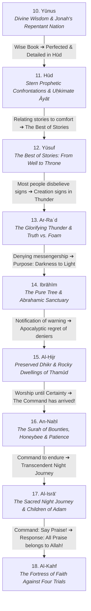

# Master Research Dossier: The Prophetic & Wisdom Cluster
## Comprehensive Sequence Analysis: Surahs 10 through 18 (Yūnus to Al-Kahf)

**Research Division:** Antigravity Qur'anic Research Engine  
**Tradition:** Orthodox Sunni *Munāsabāt* & *ʿUlūm al-Qur'ān*  
**Corpus Scope:** Surah 10 (Yūnus) through Surah 18 (Al-Kahf)  
**Primary Authorities:** Burhān al-Dīn al-Biqāʿī (*Naẓm al-durar*), Ibn al-Zubayr al-Gharnāṭī (*Al-Burhān fī tartīb suwar al-Qur'ān*), Jalāl al-Dīn al-Suyūṭī (*Tanāsuq al-durar*), Fakhr al-Dīn al-Rāzī (*Mafātīḥ al-ghayb*), Ibn ʿĀshūr (*Al-Taḥrīr wa al-tanwīr*).

---

### Core Slogan & Operating Axiom
> *"Each surah is unique and has a different personality."*  
> The central spine of the Qur'an—from Yūnus through Al-Kahf—constitutes an extraordinary progression of prophetic narratives, divine consolations, theological defenses, and empirical demonstrations of revelation, culminating in the spiritual fortress of Surah Al-Kahf.

---

## 1. Sequence Overview: Surahs 10 to 18

---

## 2. Consecutive Pairwise Investigations

### 1. Surah At-Tawbah (9) → Surah Yūnus (10)
* **The Verbal & Conceptual Handoff:**  
  At-Tawbah concludes:  
  *Laqad jā'akum rasūlun min anfusikum ʿazīzun ʿalayhi mā ʿanittum ḥarīṣun ʿalaykum... fa-in tawallaw fa-qul ḥasbiya Allāh* (9:128–129)  
  ("There has come to you a Messenger from among yourselves... so if they turn away, say: Sufficient for me is Allah.")  
  Surah Yūnus immediately opens confronting that very reaction:  
  *Alif-Lām-Rā. Tilka āyātu al-kitābi al-ḥakīm. A-kāna lil-nāsi ʿajaban an awḥaynā ilā rajulin minhum an andhiri al-nās...* (10:1–2)  
  ("Alif Lam Ra. These are the verses of the wise Book. Is it a wonder to the people that We revealed to a man from among them, 'Warn mankind and give glad tidings...?'")
* **Classical Consensus (Al-Suyūṭī, *Tanāsuq* p. 88; Ibn al-Zubayr, *Al-Burhān* p. 222):**  
  9:128 establishes that the Prophet is a mortal from among their own souls (*min anfusikum*); 10:2 immediately answers the polytheists' skeptical astonishment that revelation should descend upon a human being from among them (*ilā rajulin minhum*).

---

### 2. Surah Yūnus (10) → Surah Hūd (11)
* **The Handoff of Divine Wisdom & Structural Detail:**  
  - Yūnus concludes: *Wa-ttabiʿ mā yūḥā ilayka wa-ṣbir ḥattā yaḥkuma Allāhu wa huwa khayru al-ḥākimīn* (10:109 - "And follow what is revealed to you and be patient until Allah judges, and He is the best of judges").  
  - Hūd opens: *Alif-Lām-Rā. Kitābun uḥkimat āyātuhu thumma fuṣṣilat min ladun Ḥakīmin Khabīr* (11:1 - "Alif Lam Ra. A Book whose verses are perfected and then detailed from One who is Wise and Acquainted").  
* **Textual Architecture:**  
  10:109 ends citing *Khayr al-Ḥākimīn*; 11:1 opens announcing the Book from *Ḥakīmin Khabīr*. Furthermore, prophetic histories summarized in Yūnus (Nūḥ in 3 verses 10:71–73, Mūsā in 10:75–93) are expanded into detailed, terrifying forensic dramas in Hūd (Nūḥ across 25 verses with his son, Hūd, Ṣāliḥ, Ibrāhīm, Lūṭ, Shuʿayb, Mūsā).

---

### 3. Surah Hūd (11) → Surah Yūsuf (12)
* **From the News of the Messengers to The Best of Stories:**  
  Surah Hūd ends declaring the divine pedagogy of storytelling:  
  *Wa kullan naquṣṣu ʿalayka min anbā'i al-rusuli mā nuthabbitu bihi fu'ādak...* (11:120)  
  ("And all that We relate to you of the news of the messengers is in order to strengthen your heart therewith...")  
  Surah Yūsuf opens immediately fulfilling that promise with the crowning narrative of scripture:  
  *Naḥnu naquṣṣu ʿalayka aḥsana al-qaṣaṣi bimā awḥaynā ilayka hādhā al-qur'ān* (12:3)  
  ("We relate to you the best of stories in what We have revealed to you of this Qur'an...")
* **Al-Biqāʿī (*Naẓm al-durar* 10:5):**  
  While Hūd consoled the Prophet through narratives of destroyed nations and tragic loss, Yūsuf consoles him during the Year of Sorrow (*ʿĀm al-Ḥuzn*) through a story of ultimate triumph, familial redemption, and forgiveness following betrayal.

---

### 4. Surah Yūsuf (12) → Surah Ar-Raʿd (13)
* **The Warning of Blindness to Signs & The Roar of Creation:**  
  Surah Yūsuf ends exposing human neglect:  
  *Wa mā aktharu al-nāsi wa law ḥaraṣta bi-mu'minīn... Wa ka-ayyin min āyatin fī al-samāwāti wa al-arḍi yamurrūna ʿalayhā wa hum ʿanhā muʿriḍūn* (12:103, 105)  
  ("And most of the people, although you strive, will not believe... And how many a sign in the heavens and earth they pass by, turning away from them.")  
  Surah Ar-Raʿd opens with the identical diagnostic verdict and details those cosmic signs:  
  *Wa lākinna akthara al-nāsi lā yu'minūn* (13:1)  
  Followed in 13:2–4 and 13:13 by the living signs: the raised heavens without pillars, the sun and moon in appointed terms, the spread earth, and the thunder exalting Him in praise (*wa-yusabbiḥu al-raʿdu bi-ḥamdih*).

---

### 5. Surah Ar-Raʿd (13) → Surah Ibrāhīm (14)
* **Denial of Messengership Answered by Purpose of Revelation:**  
  Ar-Raʿd concludes with the disbelievers' challenge:  
  *Wa yaqūlu alladhīna kafarū lasta mursalā. Qul kafā bi-llāhi shahīdan baynī wa baynakum...* (13:43)  
  ("And those who disbelieve say: 'You are not a messenger.' Say: 'Sufficient is Allah as Witness between me and you...'")  
  Surah Ibrāhīm opens directly affirming the authority and mission of that messengership:  
  *Alif-Lām-Rā. Kitābun anzalnāhu ilayka li-tukhrija al-nāsa mina al-ẓulumāti ilā al-nūr bi-idhni rabbihim* (14:1)  
  ("Alif Lam Ra. A Book which We have revealed to you that you might bring mankind out of darknesses into the light by permission of their Lord...")

---

### 6. Surah Ibrāhīm (14) → Surah Al-Ḥijr (15)
* **Notification to Humanity & The Inevitable Regret of Deniers:**  
  Surah Ibrāhīm closes:  
  *Hādhā balāghun lil-nāsi wa li-yundharū bihi wa li-yaʿlamū annamā huwa ilāhun wāḥid...* (14:52)  
  ("This is a notification for the people that they may be warned by it and know that He is one God...")  
  Surah Al-Ḥijr opens portraying the eschatological horror of those who ignored that notification:  
  *Rubamā yawaddu alladhīna kafarū law kānū muslimīn* (15:2)  
  ("Perhaps those who disbelieve will wish that they had been Muslims.")  
  Surah 15 then delivers the eternal divine guarantee: *Innā naḥnu nazzalnā al-dhikra wa-innā lahu la-ḥāfiẓūn* (15:9).

---

### 7. Surah Al-Ḥijr (15) → Surah An-Naḥl (16)
* **The Command to Await the Certainty & The Immediate Arrival:**  
  - Al-Ḥijr concludes with the terminal command:  
    *Wa-ʿbud rabbaka ḥattā ya'tiyaka al-yaqīn* (15:99)  
    ("And worship your Lord until there comes to you the Certainty [death/the decree].")  
  - Surah An-Naḥl opens in the very next breath:  
    *Atā amru Allāhi fa-lā tastaʿjilūh, subḥānahu wa-taʿālā ʿammā yushrikūn* (16:1)  
    ("The command of Allah has arrived, so do not seek to hasten it. Exalted is He and high above what they associate with Him!")  
* **Al-Suyūṭī (*Tanāsuq al-durar*, p. 96):**  
  One of the most celebrated verbal junctions in the Qur'an: 15:99 commands worship until the event comes (*ya'tiyaka*), and 16:1 announces that it has indeed come (*Atā* in the past tense of absolute certainty)!

---

### 8. Surah An-Naḥl (16) → Surah Al-Isrā' (17)
* **The Supreme Exemplar of Patience Honored with the Heavenly Ascent:**  
  Surah An-Naḥl closes with the difficult moral command to the persecuted Prophet:  
  *Wa-ṣbir wa-mā ṣabruka illā bi-llāh... inna Allāha maʿa alladhīna ittaqaw wa-lladhīna hum muḥsinūn* (16:127–128)  
  ("And be patient, and your patience is not but through Allah... Indeed Allah is with those who fear Him and those who are doers of good.")  
  Surah Al-Isrā' immediately opens celebrating the supreme divine reward and honoring bestowed upon the Prophet for his endurance:  
  *Subḥāna alladhī asrā bi-ʿabdihi laylan mina al-masjidi al-ḥarāmi ilā al-masjidi al-aqṣā alladhī bāraknā ḥawlahu li-nuriyahu min āyātinā* (17:1)  
  ("Exalted is He who took His Servant by night from al-Masjid al-Haram to al-Masjid al-Aqsa, whose surroundings We have blessed, to show him of Our signs...")

---

### 9. Surah Al-Isrā' (17) → Surah Al-Kahf (18)
* **The Command of Praise Answered by the Proclamation of Praise:**  
  - Surah Al-Isrā' closes with an imperative command:  
    *Wa quli al-ḥamdu lillāhi alladhī lam yattakhidh waladan wa-lam yakun lahu sharīkun fī al-mulki...* (17:111)  
    ("And say: Praise be to Allah, who has not taken a son and has had no partner in dominion...")  
  - Surah Al-Kahf opens in the very next verse answering that exact command:  
    *Al-ḥamdu lillāhi alladhī anzala ʿalā ʿabdihi al-kitāba wa-lam yajʿal lahu ʿiwajā* (18:1)  
    ("Praise be to Allah, who has sent down upon His Servant the Book and has not made therein any crookedness.")  
* **Symmetrical Doctrinal Protection:**  
  17:111 commands praise of the One who took no son (*lam yattakhidh waladā*); 18:4 immediately clarifies the primary target of the Book's warning: *wa-yundhira alladhīna qālū ittakhadha Allāhu waladā* ("and to warn those who say, 'Allah has taken a son'").
